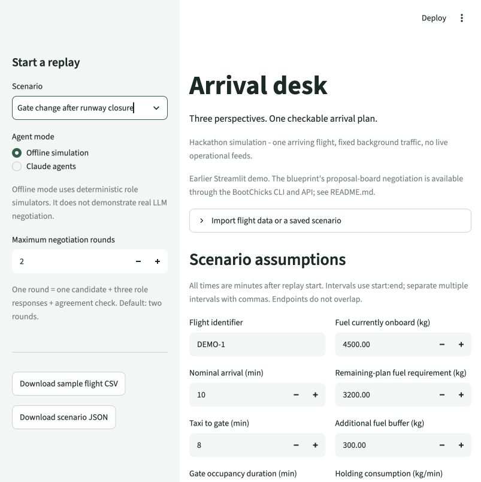
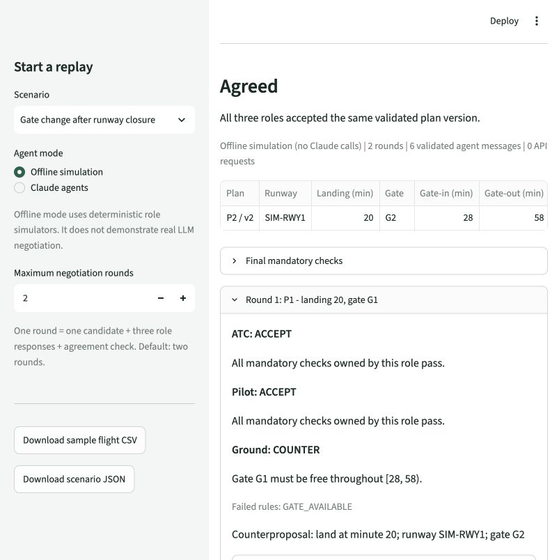
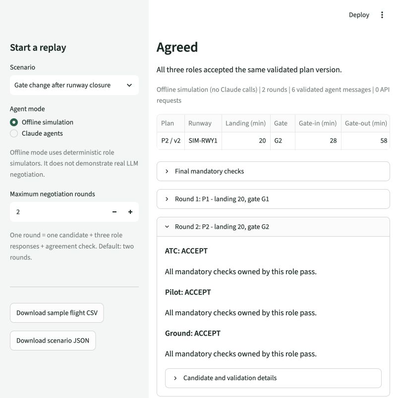
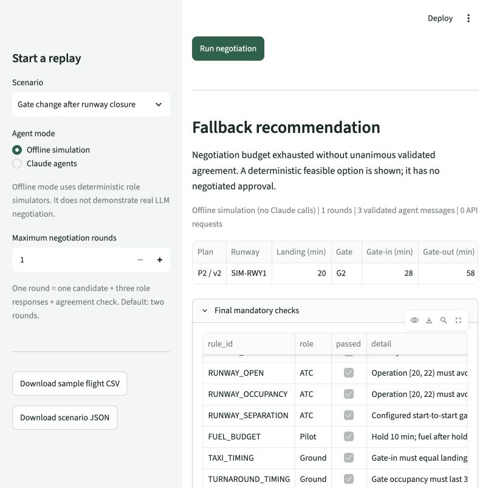
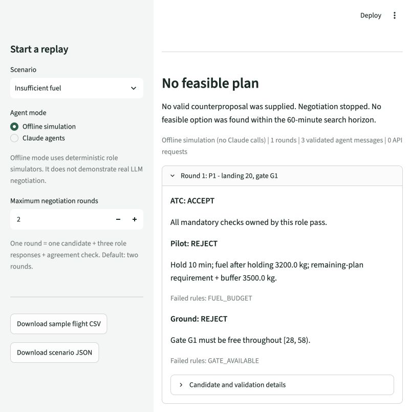

# App screenshots

Captured from the existing Streamlit Arrival desk demo on `feat/mvp`, using offline simulation and bundled synthetic data.
These images show the earlier single-candidate web workflow; the blueprint proposal-board backend is exposed through the CLI/API.
No Claude API requests were made.

## Scenario setup

Default gate-change scenario with editable assumptions and a two-round limit.



## Gate counterproposal

ATC and Pilot accept the first candidate; Ground reports the occupied original gate and proposes G2.



## Agreed plan

The second round reaches agreement on landing at minute 20, gate G2, and gate-in at minute 28.
All three roles accept the same validated version.



## Fallback recommendation

The same scenario with the round limit reduced to one returns a deterministically validated option without negotiated approval.



## Insufficient fuel

The bundled insufficient-fuel scenario rejects the proposed hold and finds no feasible option within the search horizon.



## Embed in a PR

Copy the following Markdown into the PR description.

```markdown
### App screenshots

Existing Streamlit demo, offline simulation with synthetic data.
The blueprint proposal-board backend runs through the CLI/API.


```
